# Forge Image Dependency Graph

Rendered from the actual Dockerfile `FROM` refs + `image.yaml` `depends_on` + `source:` blocks as of this document's commit. For the authoritative live state, see `grep -E "^FROM" images/*/Dockerfile`.

## Legend

- **Solid arrows** (`-->`): hard FROM dependency (parent must exist before child builds).
- **Dashed arrows** (`-.->`): COPY-from relationship — the parent is referenced but not FROMed. Covers both baseline overlay (`COPY --from=scratch_base / /`) and `/hc` healthcheck embed (`COPY --from=hc /hc /hc` — FG-031).

Images are grouped by role:
- **Upstream** (gray) — external to Forge (Docker Hub, GHCR, upstream git).
- **Forge pre-builders** (orange) — forge-rooted slim bases consumed by multiple downstream images (FG-042).
- **Forge builders** (blue) — never run at runtime; only used as builder-stage FROM refs.
- **Baseline** (green) — the shared `FROM scratch` + core closure overlay.
- **Slim runtime** (white) — consumer-facing; keeps shell + apt.
- **Scratch runtime** (yellow) — consumer-facing; `FROM scratch`.
- **External-sourced** (purple) — FG-012 pattern: Dockerfile + context pulled from an upstream git repo at build time.

## Diagram

<!-- GENERATED:dep-graph START — regenerate with `make dep-graph` -->
<!-- Auto-generated; do NOT edit this block. Run `make dep-graph` to regenerate. -->


<details>
<summary>mermaid source (editable truth — GitHub desktop renders this live; mobile shows the SVG above)</summary>

```mermaid
%% Auto-generated by scripts/image_from_graph.py --emit=mermaid.
%% Do NOT edit this block by hand; run `make dep-graph` to regenerate.
%% Legend: solid --> FROM (builder stage or runtime base);
%%         dashed -.-> COPY --from= (overlay / helper embed only).
%% Node colors: upstream (gray), pre-builder (orange), builder (blue),
%%              baseline (green), slim runtime (white), scratch runtime (yellow),
%%              external-sourced (purple).
graph TD
    subgraph L0_upstream["Layer 0 — Upstream (external to Forge)"]
        UP_BEACONRY["beaconry (source)<br/>github.com/bboortz/beaconry"]:::upstream
        UP_ALPINE["alpine:3<br/>docker.io"]:::upstream
        UP_SYFT["anchore/syft:latest<br/>docker.io"]:::upstream
        UP_DEBIAN_SID["debian:sid-slim<br/>docker.io"]:::upstream
        UP_DEBIAN_TRIXIE["debian:trixie-slim<br/>docker.io"]:::upstream
        UP_GOLANG["golang:1.27-trixie<br/>docker.io"]:::upstream
        UP_HC["hc:0.1.0<br/>ghcr.io/bboortz<br/>(static Zig healthcheck)"]:::upstream
        UP_NODE["node:24-trixie-slim<br/>docker.io"]:::upstream
        UP_POSTGRES["postgres:18<br/>docker.io"]:::upstream
        UP_PYTHON["python:3.14-slim-trixie<br/>docker.io"]:::upstream
        UP_UBUNTU["ubuntu:24.04<br/>docker.io"]:::upstream
    end
    subgraph L0_1_sources["Layer 0.1 — Upstream sources (git clone / tarball; build-time only)"]
        SRC_GH_ACTIONS_RUNNER["github.com/actions/runner"]:::upstream_source
        SRC_GH_BBOORTZ_BEACONRY["github.com/bboortz/beaconry"]:::upstream_source
        SRC_GH_GOOGLE_CADVISOR["github.com/google/cadvisor"]:::upstream_source
        SRC_GH_LOUISLAM_UPTIME_KUMA["github.com/louislam/uptime-kuma"]:::upstream_source
        SRC_GH_PROMETHEUS_COMMUNITY_IPMI_EXPORTER["github.com/prometheus-community/ipmi_exporter"]:::upstream_source
        SRC_GH_PROMETHEUS_ALERTMANAGER["github.com/prometheus/alertmanager"]:::upstream_source
        SRC_GH_PROMETHEUS_NODE_EXPORTER["github.com/prometheus/node_exporter"]:::upstream_source
        SRC_GH_PROMETHEUS_PROMETHEUS["github.com/prometheus/prometheus"]:::upstream_source
        SRC_GH_PSI_4WARD_PSITRANSFER["github.com/psi-4ward/psitransfer"]:::upstream_source
        SRC_GH_TIANON_GOSU["github.com/tianon/gosu"]:::upstream_source
        SRC_ZIGLANG_ORG_DOWNLOAD["ziglang.org/download"]:::upstream_source
    end
    subgraph L0_5_mirrors["Layer 0.5 — Forge mirrors (zero-mod upstream passthroughs; publish-mirrors tier)"]
        mirror_syft["mirror/syft"]:::mirror
    end
    subgraph L1_prebuilders["Layer 1 — Forge pre-builders (publish-pre-builders)"]
        pre-builder_alpine_3["pre-builder/alpine-3"]:::prebuilder
        pre-builder_debian_slim_sid["pre-builder/debian-slim-sid"]:::prebuilder
        pre-builder_debian_slim_trixie["pre-builder/debian-slim-trixie"]:::prebuilder
        pre-builder_go_slim_trixie["pre-builder/go-slim-trixie"]:::prebuilder
        pre-builder_node_slim_trixie["pre-builder/node-slim-trixie"]:::prebuilder
        pre-builder_python_slim_trixie["pre-builder/python-slim-trixie"]:::prebuilder
        pre-builder_ubuntu_slim_noble["pre-builder/ubuntu-slim-noble"]:::prebuilder
        pre-builder_zig_slim_trixie["pre-builder/zig-slim-trixie"]:::prebuilder
    end
    subgraph L2_builders["Layer 2 — Forge builders (publish-builders — never runtime)"]
        builder_go_trixie["builder/go-trixie"]:::builder
        builder_node_trixie["builder/node-trixie"]:::builder
        builder_python_trixie["builder/python-trixie"]:::builder
        builder_zig_trixie["builder/zig-trixie"]:::builder
    end
    subgraph L3_baseline["Layer 3 — Forge baseline (publish-base — scratch overlay)"]
        base_alpine_3["base/alpine-3"]:::baseline
        base_debian_slim_trixie["base/debian-slim-trixie"]:::baseline
        base_node_slim_trixie["base/node-slim-trixie"]:::baseline
        base_python_scratch_trixie["base/python-scratch-trixie"]:::baseline
        base_python_slim_trixie["base/python-slim-trixie"]:::baseline
        base_scratch_trixie["base/scratch-trixie"]:::baseline
        base_ubuntu_slim_noble["base/ubuntu-slim-noble"]:::baseline
    end
    subgraph L4_runtimes["Layer 4 — Runtimes (publish-base tail + publish-derivatives)"]
        alertmanager-scratch-trixie:::scratch
        beaconry-hub:::external
        beaconry-scout:::external
        beaconry-telegram-mock:::external
        cadvisor-slim-trixie:::slim
        github-runner-noble:::slim
        healthy-scratch-trixie:::scratch
        ipmi-exporter-scratch-trixie:::scratch
        ipmi-exporter-slim-trixie:::slim
        mosquitto-scratch-trixie:::scratch
        nginx-scratch-trixie:::scratch
        node-exporter-scratch-trixie:::scratch
        postgres-scratch-trixie:::scratch
        postgres-slim-trixie:::slim
        prometheus-scratch-trixie:::scratch
        psitransfer-slim-trixie:::slim
        redis-scratch-trixie:::scratch
        uptime-kuma-slim-trixie:::slim
    end

    %% FG-076 legend — 5 edge classes × tier-of-source palette
    subgraph Legend["Edge legend (shape = relationship · color = tier of source)"]
        direction LR
        L_C1_SRC[" "]:::legend_node
        L_C1_DST["Class 1 · FROM-parent (final-stage; trust + CVEs propagate)"]:::legend_node
        L_C2_SRC[" "]:::legend_node
        L_C2_DST["Class 2 · FROM builder-stage (content discarded in child)"]:::legend_node
        L_C3_SRC[" "]:::legend_node
        L_C3_DST["Class 3 · COPY --from (overlay / tool)"]:::legend_node
        L_C4_SRC[" "]:::legend_node
        L_C4_DST["Class 4 · external upstream image (L0, red)"]:::legend_node
        L_C5_SRC[" "]:::legend_node
        L_C5_DST["Class 5 · L0.1 upstream source (orange, build-time clone/tarball)"]:::legend_node
        L_C1_SRC ==> L_C1_DST
        L_C2_SRC --> L_C2_DST
        L_C3_SRC -.-> L_C3_DST
        L_C4_SRC ==> L_C4_DST
        L_C5_SRC -.-> L_C5_DST
    end

    %% FG-076 classified edges (shape + color encode semantic class + source tier)
    UP_ALPINE ==> pre-builder_alpine_3
    UP_SYFT ==> mirror_syft
    UP_DEBIAN_SID ==> pre-builder_debian_slim_sid
    UP_DEBIAN_TRIXIE ==> pre-builder_debian_slim_trixie
    UP_GOLANG ==> pre-builder_go_slim_trixie
    UP_NODE ==> pre-builder_node_slim_trixie
    UP_POSTGRES ==> postgres-slim-trixie
    UP_PYTHON ==> pre-builder_python_slim_trixie
    UP_UBUNTU ==> pre-builder_ubuntu_slim_noble
    builder_go_trixie --> alertmanager-scratch-trixie
    builder_node_trixie --> alertmanager-scratch-trixie
    pre-builder_alpine_3 ==> base_alpine_3
    pre-builder_debian_slim_trixie ==> base_debian_slim_trixie
    pre-builder_node_slim_trixie ==> base_node_slim_trixie
    builder_python_trixie --> base_python_scratch_trixie
    pre-builder_python_slim_trixie ==> base_python_slim_trixie
    builder_python_trixie --> base_scratch_trixie
    pre-builder_ubuntu_slim_noble ==> base_ubuntu_slim_noble
    base_python_scratch_trixie --> beaconry-hub
    base_python_scratch_trixie --> beaconry-scout
    base_python_scratch_trixie --> beaconry-telegram-mock
    pre-builder_go_slim_trixie ==> builder_go_trixie
    pre-builder_node_slim_trixie ==> builder_node_trixie
    pre-builder_python_slim_trixie ==> builder_python_trixie
    pre-builder_zig_slim_trixie ==> builder_zig_trixie
    base_debian_slim_trixie ==> cadvisor-slim-trixie
    builder_go_trixie --> cadvisor-slim-trixie
    base_ubuntu_slim_noble ==> github-runner-noble
    builder_python_trixie --> healthy-scratch-trixie
    builder_go_trixie --> ipmi-exporter-scratch-trixie
    builder_python_trixie --> ipmi-exporter-scratch-trixie
    base_debian_slim_trixie ==> ipmi-exporter-slim-trixie
    builder_go_trixie --> ipmi-exporter-slim-trixie
    builder_python_trixie --> mosquitto-scratch-trixie
    builder_python_trixie --> nginx-scratch-trixie
    builder_go_trixie --> node-exporter-scratch-trixie
    builder_python_trixie --> postgres-scratch-trixie
    builder_go_trixie --> postgres-slim-trixie
    pre-builder_debian_slim_trixie ==> pre-builder_zig_slim_trixie
    builder_go_trixie --> prometheus-scratch-trixie
    builder_node_trixie --> prometheus-scratch-trixie
    base_node_slim_trixie ==> psitransfer-slim-trixie
    builder_node_trixie --> psitransfer-slim-trixie
    builder_python_trixie --> redis-scratch-trixie
    base_node_slim_trixie ==> uptime-kuma-slim-trixie
    builder_node_trixie --> uptime-kuma-slim-trixie
    base_scratch_trixie -.-> alertmanager-scratch-trixie
    base_scratch_trixie -.-> base_python_scratch_trixie
    base_scratch_trixie -.-> ipmi-exporter-scratch-trixie
    base_scratch_trixie -.-> mosquitto-scratch-trixie
    base_scratch_trixie -.-> nginx-scratch-trixie
    base_scratch_trixie -.-> node-exporter-scratch-trixie
    base_scratch_trixie -.-> postgres-scratch-trixie
    base_scratch_trixie -.-> prometheus-scratch-trixie
    base_scratch_trixie -.-> redis-scratch-trixie
    mirror_syft -.-> builder_go_trixie
    mirror_syft -.-> builder_node_trixie
    mirror_syft -.-> builder_python_trixie
    mirror_syft -.-> builder_zig_trixie
    UP_HC -.-> alertmanager-scratch-trixie
    UP_HC -.-> base_alpine_3
    UP_HC -.-> base_debian_slim_trixie
    UP_HC -.-> base_node_slim_trixie
    UP_HC -.-> base_python_scratch_trixie
    UP_HC -.-> base_python_slim_trixie
    UP_HC -.-> base_ubuntu_slim_noble
    UP_HC -.-> cadvisor-slim-trixie
    UP_HC -.-> healthy-scratch-trixie
    UP_HC -.-> ipmi-exporter-scratch-trixie
    UP_HC -.-> ipmi-exporter-slim-trixie
    UP_HC -.-> nginx-scratch-trixie
    UP_HC -.-> node-exporter-scratch-trixie
    UP_HC -.-> prometheus-scratch-trixie
    UP_HC -.-> psitransfer-slim-trixie
    UP_HC -.-> uptime-kuma-slim-trixie
    SRC_GH_ACTIONS_RUNNER -.-> github-runner-noble
    SRC_GH_BBOORTZ_BEACONRY -.-> beaconry-hub
    SRC_GH_BBOORTZ_BEACONRY -.-> beaconry-scout
    SRC_GH_BBOORTZ_BEACONRY -.-> beaconry-telegram-mock
    SRC_GH_GOOGLE_CADVISOR -.-> cadvisor-slim-trixie
    SRC_GH_LOUISLAM_UPTIME_KUMA -.-> uptime-kuma-slim-trixie
    SRC_GH_PROMETHEUS_COMMUNITY_IPMI_EXPORTER -.-> ipmi-exporter-scratch-trixie
    SRC_GH_PROMETHEUS_COMMUNITY_IPMI_EXPORTER -.-> ipmi-exporter-slim-trixie
    SRC_GH_PROMETHEUS_ALERTMANAGER -.-> alertmanager-scratch-trixie
    SRC_GH_PROMETHEUS_NODE_EXPORTER -.-> node-exporter-scratch-trixie
    SRC_GH_PROMETHEUS_PROMETHEUS -.-> prometheus-scratch-trixie
    SRC_GH_PSI_4WARD_PSITRANSFER -.-> psitransfer-slim-trixie
    SRC_GH_TIANON_GOSU -.-> postgres-slim-trixie
    SRC_ZIGLANG_ORG_DOWNLOAD -.-> pre-builder_zig_slim_trixie

    %% FG-076 linkStyle pins — one per emitted edge, in emission order
    linkStyle 0 stroke:#6D4C41,stroke-width:5px;
    linkStyle 1 stroke:#6D4C41,stroke-width:4px;
    linkStyle 2 stroke:#6D4C41,stroke-width:4px;
    linkStyle 3 stroke:#D81B60,stroke-width:5px;
    linkStyle 4 stroke:#E65100,stroke-width:3px,stroke-dasharray: 1,3;
    linkStyle 5 stroke:#D81B60,stroke-width:5px;
    linkStyle 6 stroke:#D81B60,stroke-width:5px;
    linkStyle 7 stroke:#D81B60,stroke-width:5px;
    linkStyle 8 stroke:#D81B60,stroke-width:5px;
    linkStyle 9 stroke:#D81B60,stroke-width:5px;
    linkStyle 10 stroke:#D81B60,stroke-width:5px;
    linkStyle 11 stroke:#D81B60,stroke-width:5px;
    linkStyle 12 stroke:#D81B60,stroke-width:5px;
    linkStyle 13 stroke:#D81B60,stroke-width:5px;
    linkStyle 14 stroke:#1E88E5,stroke-width:4px;
    linkStyle 15 stroke:#1E88E5,stroke-width:4px;
    linkStyle 16 stroke:#43A047,stroke-width:5px;
    linkStyle 17 stroke:#43A047,stroke-width:5px;
    linkStyle 18 stroke:#43A047,stroke-width:5px;
    linkStyle 19 stroke:#1E88E5,stroke-width:4px;
    linkStyle 20 stroke:#43A047,stroke-width:5px;
    linkStyle 21 stroke:#1E88E5,stroke-width:4px;
    linkStyle 22 stroke:#43A047,stroke-width:5px;
    linkStyle 23 stroke:#6D4C41,stroke-width:4px;
    linkStyle 24 stroke:#6D4C41,stroke-width:4px;
    linkStyle 25 stroke:#6D4C41,stroke-width:4px;
    linkStyle 26 stroke:#43A047,stroke-width:5px;
    linkStyle 27 stroke:#43A047,stroke-width:5px;
    linkStyle 28 stroke:#43A047,stroke-width:5px;
    linkStyle 29 stroke:#43A047,stroke-width:5px;
    linkStyle 30 stroke:#6D4C41,stroke-width:5px;
    linkStyle 31 stroke:#1E88E5,stroke-width:4px;
    linkStyle 32 stroke:#6D4C41,stroke-width:5px;
    linkStyle 33 stroke:#1E88E5,stroke-width:4px;
    linkStyle 34 stroke:#1E88E5,stroke-width:4px;
    linkStyle 35 stroke:#1E88E5,stroke-width:4px;
    linkStyle 36 stroke:#6D4C41,stroke-width:5px;
    linkStyle 37 stroke:#1E88E5,stroke-width:4px;
    linkStyle 38 stroke:#1E88E5,stroke-width:4px;
    linkStyle 39 stroke:#1E88E5,stroke-width:4px;
    linkStyle 40 stroke:#1E88E5,stroke-width:4px;
    linkStyle 41 stroke:#1E88E5,stroke-width:4px;
    linkStyle 42 stroke:#1E88E5,stroke-width:4px;
    linkStyle 43 stroke:#43A047,stroke-width:5px;
    linkStyle 44 stroke:#1E88E5,stroke-width:4px;
    linkStyle 45 stroke:#1E88E5,stroke-width:4px;
    linkStyle 46 stroke:#6D4C41,stroke-width:5px;
    linkStyle 47 stroke:#1E88E5,stroke-width:4px;
    linkStyle 48 stroke:#1E88E5,stroke-width:4px;
    linkStyle 49 stroke:#6D4C41,stroke-width:5px;
    linkStyle 50 stroke:#1E88E5,stroke-width:4px;
    linkStyle 51 stroke:#6D4C41,stroke-width:4px;
    linkStyle 52 stroke:#6D4C41,stroke-width:4px;
    linkStyle 53 stroke:#6D4C41,stroke-width:4px;
    linkStyle 54 stroke:#6D4C41,stroke-width:4px;
    linkStyle 55 stroke:#6D4C41,stroke-width:4px;
    linkStyle 56 stroke:#6D4C41,stroke-width:4px;
    linkStyle 57 stroke:#6D4C41,stroke-width:4px;
    linkStyle 58 stroke:#6D4C41,stroke-width:4px;
    linkStyle 59 stroke:#6D4C41,stroke-width:4px;
    linkStyle 60 stroke:#FBC02D,stroke-width:4px;
    linkStyle 61 stroke:#FBC02D,stroke-width:4px;
    linkStyle 62 stroke:#FBC02D,stroke-width:4px;
    linkStyle 63 stroke:#FBC02D,stroke-width:4px;
    linkStyle 64 stroke:#D81B60,stroke-width:4px;
    linkStyle 65 stroke:#D81B60,stroke-width:4px;
    linkStyle 66 stroke:#D81B60,stroke-width:4px;
    linkStyle 67 stroke:#D81B60,stroke-width:4px;
    linkStyle 68 stroke:#D81B60,stroke-width:4px;
    linkStyle 69 stroke:#D81B60,stroke-width:4px;
    linkStyle 70 stroke:#D81B60,stroke-width:4px;
    linkStyle 71 stroke:#D81B60,stroke-width:4px;
    linkStyle 72 stroke:#D81B60,stroke-width:4px;
    linkStyle 73 stroke:#D81B60,stroke-width:4px;
    linkStyle 74 stroke:#D81B60,stroke-width:4px;
    linkStyle 75 stroke:#D81B60,stroke-width:4px;
    linkStyle 76 stroke:#D81B60,stroke-width:4px;
    linkStyle 77 stroke:#D81B60,stroke-width:4px;
    linkStyle 78 stroke:#D81B60,stroke-width:4px;
    linkStyle 79 stroke:#D81B60,stroke-width:4px;
    linkStyle 80 stroke:#E65100,stroke-width:3px,stroke-dasharray: 1,3;
    linkStyle 81 stroke:#E65100,stroke-width:3px,stroke-dasharray: 1,3;
    linkStyle 82 stroke:#E65100,stroke-width:3px,stroke-dasharray: 1,3;
    linkStyle 83 stroke:#E65100,stroke-width:3px,stroke-dasharray: 1,3;
    linkStyle 84 stroke:#E65100,stroke-width:3px,stroke-dasharray: 1,3;
    linkStyle 85 stroke:#E65100,stroke-width:3px,stroke-dasharray: 1,3;
    linkStyle 86 stroke:#E65100,stroke-width:3px,stroke-dasharray: 1,3;
    linkStyle 87 stroke:#E65100,stroke-width:3px,stroke-dasharray: 1,3;
    linkStyle 88 stroke:#E65100,stroke-width:3px,stroke-dasharray: 1,3;
    linkStyle 89 stroke:#E65100,stroke-width:3px,stroke-dasharray: 1,3;
    linkStyle 90 stroke:#E65100,stroke-width:3px,stroke-dasharray: 1,3;
    linkStyle 91 stroke:#E65100,stroke-width:3px,stroke-dasharray: 1,3;
    linkStyle 92 stroke:#E65100,stroke-width:3px,stroke-dasharray: 1,3;
    linkStyle 93 stroke:#E65100,stroke-width:3px,stroke-dasharray: 1,3;

    %% Node styling
    classDef upstream   fill:#eeeeee,stroke:#999,stroke-width:1px,color:#333;
    classDef upstream_source fill:#fef3c7,stroke:#a16207,stroke-width:1px,color:#713f12,font-style:italic;
    classDef prebuilder fill:#fed7aa,stroke:#c2410c,stroke-width:2px,color:#7c2d12;
    classDef builder    fill:#dbeafe,stroke:#1e40af,stroke-width:2px,color:#1e3a8a;
    classDef baseline   fill:#bbf7d0,stroke:#166534,stroke-width:2px,color:#14532d;
    classDef slim       fill:#ffffff,stroke:#333,stroke-width:1px,color:#111;
    classDef scratch    fill:#fef3c7,stroke:#b45309,stroke-width:1px,color:#78350f;
    classDef external   fill:#ede9fe,stroke:#6d28d9,stroke-width:1px,color:#4c1d95;
    classDef mirror     fill:#99f6e4,stroke:#0f766e,stroke-width:2px,color:#134e4a;
    classDef legend_node fill:#ffffff,stroke:#999,stroke-width:1px,color:#333,font-size:11px;
```

</details>
<!-- GENERATED:dep-graph END -->

## Facts behind the graph

### Trust-anchor consolidation (FG-042 → FG-051 → FG-058 → FG-061)

Every upstream Docker Hub anchor that fronts a generic slim base is consumed by **exactly one** forge pre-builder. Downstream slim / scratch images FROM the forge pre-builder, not the upstream directly.

| Upstream | Forge pre-builder | Downstream consumers |
|---|---|---|
| `python:3.14-slim-trixie` | `python-slim-trixie` (FG-001) | `forge-builder-python-trixie` (dogfood) |
| `debian:trixie-slim` | `debian-slim-trixie` (FG-042) | `cadvisor-slim-trixie`, `ipmi-exporter-slim-trixie` |
| `debian:sid-slim` | `debian-slim-sid` (FG-058) | — (escape-hatch infra for CVEs sid patches but trixie doesn't) |
| `ubuntu:24.04` | `ubuntu-slim-noble` (FG-051) | `github-runner-noble` |
| `node:24-trixie-slim` | `node-slim-trixie` (FG-061) | `uptime-kuma-slim-trixie` (runtime) |

Grep-invariant enforced by `scripts/verify-no-upstream-drift.sh`: `^FROM (debian:trixie-slim|debian:sid-slim|python:3.14-slim-trixie|ubuntu:24.04|node:24-trixie-slim)` matches exactly **5** Dockerfiles — the five pre-builders above. Everyone else goes through forge-signed intermediates.

### Dedicated-toolchain exemptions

Three upstreams bypass the pre-builder rule by design — each has exactly one Forge consumer and uses ARG-indirect `FROM ${X_BASE}` (not grep-matched by the drift guard):

| Upstream | Forge consumer | Why exempted |
|---|---|---|
| `golang:1.27-trixie` | `forge-builder-go-trixie` | Debian-packaged Go lags upstream by 3+ minor versions → stdlib CVE class. |
| `node:24-trixie-slim` | `forge-builder-node-trixie` | Debian-packaged Node is far behind the active LTS line. |
| `postgres:18` | `postgres-slim-trixie` | Compiling postgres from source is bigger than the drift risk justifies. |

Note: `node:24-trixie-slim` is **both** an anchor (via `node-slim-trixie`) and an exemption (via `forge-builder-node-trixie`). The literal `^FROM node:24-trixie-slim` fires once (pre-builder); the builder uses ARG indirection and so doesn't count toward `_EXPECTED`.

### Four-tier publish ordering

`.github/workflows/build.yml` publishes in this order (each tier gated on the previous via `needs:`):

1. **`publish-pre-builders`** (FG-042/051/058/061): `debian-slim-sid`, `debian-slim-trixie`, `node-slim-trixie`, `python-slim-trixie`, `ubuntu-slim-noble` in parallel.
2. **`publish-builders`** (FG-025/046/048): `forge-builder-go-trixie`, `forge-builder-node-trixie`, `forge-builder-python-trixie`. `forge-builder-python-trixie` FROMs `python-slim-trixie` (dogfood), so tier 1 must complete first.
3. **`publish-base`**: `scratch-base-trixie` + remaining single-consumer slim images + consumer-facing images (`cadvisor-slim`, `github-runner-noble`, `healthy-scratch`, `ipmi-exporter-slim`, `postgres-slim`, `uptime-kuma-slim`).
4. **`publish-derivatives`**: everything with `depends_on` (scratch variants + beaconry hub/scout/telegram-mock).

### Three builder lineages

1. **Python / Debian-apt builder** — `forge-builder-python-trixie` (FG-025, extended by FG-042): FROMs forge-signed `python-slim-trixie`. Used as the builder stage for every Debian-apt-install image. Current consumers: `scratch-base-trixie`, `python-scratch`, `nginx-scratch`, `postgres-scratch`, `redis-scratch`, `mosquitto-scratch`, `healthy-scratch`, `ipmi-exporter-scratch` (as C-builder).

2. **Go builder** — `forge-builder-go-trixie` (FG-046): `FROM golang:1.27-trixie` + apt-upgrade + CA + syft + git/curl/jq. Current consumers: `cadvisor-slim`, `node-exporter-scratch`, `alertmanager-scratch`, `prometheus-scratch`, `ipmi-exporter-{slim,scratch}`, `postgres-slim` (for building `gosu` from source — FG-054).

3. **Node builder** — `forge-builder-node-trixie` (FG-048): `FROM node:24-trixie-slim` + apt-upgrade + CA + syft + git/curl/jq + make/g++/python3 + dumb-init + corepack. Current consumers: `uptime-kuma-slim` (builder stage), `prometheus-scratch` (UI builder — React), `alertmanager-scratch` (UI builder — dual Elm + Mantine).

4. **Scratch baseline** — `scratch-base-trixie` (FG-005): the single `FROM scratch` image with glibc + CA + nss closure that every Forge scratch derivative overlays via `COPY --from=scratch_base / /`.

### Dual-/triple-builder patterns

- **`ipmi-exporter-scratch-trixie`** — dual-builder: `forge-builder-go-trixie` (go-builder, exporter binary) + `forge-builder-python-trixie` (c-builder, freeipmi tools via apt-install).
- **`prometheus-scratch-trixie`** — dual-builder: `forge-builder-node-trixie` (React UI via `npm run build` + `-tags builtinassets`) + `forge-builder-go-trixie` (prometheus + promtool binaries).
- **`alertmanager-scratch-trixie`** — dual-builder: `forge-builder-node-trixie` (both Elm classic UI + Mantine UI) + `forge-builder-go-trixie` (alertmanager binary — FG-052).

### `/hc` embed

`ghcr.io/bboortz/hc:0.1.0` is a ~400 KB static Zig binary implementing `/hc <url>` for in-container Docker `HEALTHCHECK`. Every image with a documented HEALTHCHECK carries it via `COPY --from=hc /hc /hc`. Independent of the builder/runtime chain.

### External-sourced (FG-012)

`beaconry-scout`, `beaconry-hub`, and `beaconry-telegram-mock` pull their Dockerfiles from `github.com/bboortz/beaconry` at build time (`source:` block in `image.yaml` names the git ref + dockerfile path). All three now FROM `python-scratch-trixie` — `beaconry-telegram-mock` was migrated off upstream `python:3.12-slim` in beaconry BC-100 to put every externally-sourced consumer on the forge-signed chain.

### Chain depth invariant (FG-042)

Current deepest chain: `debian:trixie-slim` (Docker Hub) → `python:3.14-slim-trixie` (Docker Hub) → `python-slim-trixie` (forge pre-builder) → `forge-builder-python-trixie` (forge builder) → `scratch-base-trixie` (forge baseline) → `python-scratch-trixie` / `nginx-scratch-trixie` / etc. = **5 hops to a scratch runtime** (cap). Node chain is shorter: `debian:trixie-slim` → `node:24-trixie-slim` → `node-slim-trixie` → `uptime-kuma-slim-trixie` = 3 hops.

## Regenerating

```bash
# Inspect current FROMs
grep -E "^FROM" images/*/Dockerfile

# Inspect declared depends_on
grep -lE "^depends_on:" images/*/image.yaml | xargs -r awk '/^depends_on:/,/^[^- ]/' /dev/null

# Inspect external-sourced
grep -lE "^source:" images/*/image.yaml

# Inspect pre-builders / builders / base / derivatives tier classification
for mode in pre-builders builders base derivatives; do
  echo "=== ${mode} ==="
  bash scripts/discover-images.sh "${mode}" | jq -r '.include[].image_dir'
done
```
