# Forge Image Dependency Graph

Rendered from the actual Dockerfile `FROM` refs + `image.yaml` `depends_on` + `source:` blocks as of this document's commit. For the authoritative live state, see `grep -E "^FROM" images/*/Dockerfile`.

## Legend

- **Solid arrows** (`-->`): hard FROM dependency (parent must exist before child builds).
- **Dashed arrows** (`-.->`): COPY-from relationship — the parent is referenced but not FROMed. Covers both baseline overlay (`COPY --from=scratch_base / /`) and `/hc` healthcheck embed (`COPY --from=hc /hc /hc` — FG-031).

Images are grouped by role:
- **Upstream** (gray) — external to Forge (Docker Hub, GHCR).
- **Forge pre-builders** (orange) — forge-rooted slim bases consumed by multiple downstream images (FG-042).
- **Forge builders** (blue) — never run at runtime; only used as builder-stage FROM refs.
- **Baseline** (green) — the shared `FROM scratch` + core closure overlay.
- **Runtime** (white) — what consumers actually `docker run`.
- **External-sourced** (purple) — FG-012 pattern: Dockerfile + context pulled from an upstream git repo at build time.

## Diagram

```mermaid
graph TD
    %% ======================================================================
    %% Upstream (external to Forge)
    %% ======================================================================
    PY_UP["python:3.14-slim-trixie<br/>docker.io"]:::upstream
    GO_UP["golang:1.27-trixie<br/>docker.io"]:::upstream
    NODE_UP["node:22-trixie-slim<br/>docker.io"]:::upstream
    DEBIAN_UP["debian:trixie-slim<br/>docker.io"]:::upstream
    POSTGRES_UP["postgres:18<br/>docker.io"]:::upstream
    SYFT_UP["anchore/syft:latest<br/>docker.io"]:::upstream
    HC_UP["hc:0.1.0<br/>ghcr.io/bboortz<br/>(static Zig healthcheck)"]:::upstream
    BEACONRY_SRC["beaconry (source)<br/>github.com/bboortz/beaconry"]:::upstream

    %% ======================================================================
    %% Forge pre-builders (FG-042 — forge-rooted slim bases)
    %% ======================================================================
    DEBIAN_SLIM["debian-slim-trixie<br/>FG-042 • apt-upgraded + CA"]:::prebuilder
    PYSLIM["python-slim-trixie<br/>FG-001 • apt-upgraded + python3.14"]:::prebuilder

    %% ======================================================================
    %% Forge builders (never runtime)
    %% ======================================================================
    FBT["forge-builder-trixie<br/>FG-025 + FG-042 • dogfoods python-slim-trixie"]:::builder
    FBG["forge-builder-go-trixie<br/>FG-046 • Go1.27+syft"]:::builder

    %% ======================================================================
    %% Forge baseline
    %% ======================================================================
    SBT["scratch-base-trixie<br/>FG-005 • glibc+CA+nss"]:::baseline

    %% ======================================================================
    %% Slim runtimes (keep shell, apt kept)
    %% ======================================================================
    POSTGRES_SLIM["postgres-slim-trixie<br/>FG-026"]:::slim
    IPMI_SLIM["ipmi-exporter-slim-trixie<br/>FG-037 + FG-046 + FG-042"]:::slim
    CADVISOR["cadvisor-slim-trixie<br/>FG-044 + FG-046 + FG-042"]:::slim
    UK["uptime-kuma-slim-trixie<br/>FG-045"]:::slim

    %% ======================================================================
    %% Scratch runtimes (FROM scratch + baseline overlay)
    %% ======================================================================
    PYSCR["python-scratch-trixie<br/>FG-003 + FG-009/011"]:::scratch
    NGINX["nginx-scratch-trixie<br/>FG-006 + FG-016/039/040"]:::scratch
    POSTGRES_SCR["postgres-scratch-trixie<br/>FG-007 + FG-026"]:::scratch
    REDIS["redis-scratch-trixie<br/>FG-027"]:::scratch
    MOSQ["mosquitto-scratch-trixie<br/>FG-028"]:::scratch
    HEALTHY["healthy-scratch-trixie<br/>FG-029"]:::scratch
    NODE_EX["node-exporter-scratch-trixie<br/>FG-034 + FG-046"]:::scratch
    PROM["prometheus-scratch-trixie<br/>FG-035 + FG-039/040"]:::scratch
    AM["alertmanager-scratch-trixie<br/>FG-036 + FG-046"]:::scratch
    IPMI_SCR["ipmi-exporter-scratch-trixie<br/>FG-043 + FG-046"]:::scratch

    %% ======================================================================
    %% External-sourced (FG-012 pattern)
    %% ======================================================================
    SCOUT["beaconry-scout<br/>FG-012"]:::external
    HUB["beaconry-hub<br/>FG-014"]:::external
    MOCK["beaconry-telegram-mock<br/>FG-015"]:::external

    %% ----------------------------------------------------------------------
    %% Upstream -> Forge pre-builders (FG-042 — each upstream consumed by exactly 1 forge image)
    %% ----------------------------------------------------------------------
    DEBIAN_UP --> DEBIAN_SLIM
    PY_UP --> PYSLIM

    %% ----------------------------------------------------------------------
    %% Forge pre-builders -> downstream
    %% ----------------------------------------------------------------------
    PYSLIM --> FBT
    DEBIAN_SLIM --> CADVISOR
    DEBIAN_SLIM --> IPMI_SLIM

    %% ----------------------------------------------------------------------
    %% Remaining upstream direct consumers (single-consumer each)
    %% ----------------------------------------------------------------------
    GO_UP --> FBG
    NODE_UP --> UK
    POSTGRES_UP --> POSTGRES_SLIM

    %% ----------------------------------------------------------------------
    %% syft pulled into builder-stage images
    %% ----------------------------------------------------------------------
    SYFT_UP --> FBT
    SYFT_UP --> FBG
    SYFT_UP --> UK

    %% ----------------------------------------------------------------------
    %% Forge builders used as builder-stage FROMs
    %% ----------------------------------------------------------------------
    FBT --> SBT
    FBT --> PYSCR
    FBT --> NGINX
    FBT --> POSTGRES_SCR
    FBT --> REDIS
    FBT --> MOSQ
    FBT --> HEALTHY
    FBT --> PROM
    FBT --> IPMI_SCR

    FBG --> CADVISOR
    FBG --> NODE_EX
    FBG --> AM
    FBG --> IPMI_SCR
    FBG --> IPMI_SLIM

    %% ----------------------------------------------------------------------
    %% Baseline overlay into scratch runtimes
    %% ----------------------------------------------------------------------
    SBT -.-> PYSCR
    SBT -.-> NGINX
    SBT -.-> POSTGRES_SCR
    SBT -.-> REDIS
    SBT -.-> MOSQ
    SBT -.-> HEALTHY
    SBT -.-> NODE_EX
    SBT -.-> PROM
    SBT -.-> AM
    SBT -.-> IPMI_SCR

    %% ----------------------------------------------------------------------
    %% /hc embed (FG-031) — healthcheck binary
    %% ----------------------------------------------------------------------
    HC_UP -.-> PYSCR
    HC_UP -.-> NGINX
    HC_UP -.-> POSTGRES_SCR
    HC_UP -.-> HEALTHY
    HC_UP -.-> NODE_EX
    HC_UP -.-> PROM
    HC_UP -.-> AM
    HC_UP -.-> IPMI_SCR
    HC_UP -.-> IPMI_SLIM
    HC_UP -.-> CADVISOR
    HC_UP -.-> UK

    %% ----------------------------------------------------------------------
    %% External-sourced (beaconry) — FROM forge images
    %% ----------------------------------------------------------------------
    BEACONRY_SRC -.-> SCOUT
    BEACONRY_SRC -.-> HUB
    BEACONRY_SRC -.-> MOCK
    PYSCR --> SCOUT
    PYSCR --> HUB
    PY_UP --> MOCK

    %% ======================================================================
    %% Styling
    %% ======================================================================
    classDef upstream   fill:#eeeeee,stroke:#999,stroke-width:1px,color:#333;
    classDef prebuilder fill:#fed7aa,stroke:#c2410c,stroke-width:2px,color:#7c2d12;
    classDef builder    fill:#dbeafe,stroke:#1e40af,stroke-width:2px,color:#1e3a8a;
    classDef baseline   fill:#bbf7d0,stroke:#166534,stroke-width:2px,color:#14532d;
    classDef slim       fill:#ffffff,stroke:#333,stroke-width:1px,color:#111;
    classDef scratch    fill:#fef3c7,stroke:#b45309,stroke-width:1px,color:#78350f;
    classDef external   fill:#ede9fe,stroke:#6d28d9,stroke-width:1px,color:#4c1d95;
```



## Facts behind the graph

### Trust-anchor consolidation (FG-042, 2026-11-10)

Before FG-042, 5 Docker Hub upstream images were trust-anchors for the forge fleet, and **two of them were consumed by multiple forge images in parallel** — making version drift a code-review discipline rather than a structural guarantee.

| Upstream | Before FG-042 | After FG-042 |
|---|---|---|
| `python:3.14-slim-trixie` | 2 forge consumers (forge-builder-trixie + python-slim-trixie) | 1 forge consumer (python-slim-trixie only); forge-builder-trixie dogfood-FROMs python-slim-trixie |
| `debian:trixie-slim` | 2 forge consumers (cadvisor-slim + ipmi-exporter-slim) | 1 forge consumer (new `debian-slim-trixie`); both downstream slim images FROM it |
| `golang:1.27-trixie` | 1 consumer (forge-builder-go-trixie) | unchanged |
| `node:22-trixie-slim` | 1 consumer (uptime-kuma-slim-trixie) | unchanged (tracked in IDEAS.md for renewal if 2nd Node consumer appears) |
| `postgres:18` | 1 consumer (postgres-slim-trixie) | unchanged (tracked in IDEAS.md) |

Grep-invariant checked by `test_FG_042_...sh` §7: `^FROM (debian:trixie-slim\|python:3.14-slim-trixie)` matches exactly 2 Dockerfiles — the two pre-builders. Everyone else goes through forge-signed intermediates.

### Four-tier publish ordering (FG-042)

`.github/workflows/build.yml` publishes in this order:

1. `publish-pre-builders` (NEW — FG-042): `debian-slim-trixie`, `python-slim-trixie` in parallel
2. `publish-builders`: `forge-builder-trixie` (FROM python-slim-trixie), `forge-builder-go-trixie`
3. `publish-base`: `scratch-base-trixie` + the remaining single-consumer slim images + externally-sourced leaf images
4. `publish-derivatives`: everything with `depends_on` (scratch variants + beaconry hub/scout)

Each tier gated on the previous completing via `needs:`.

### Three builder lineages

1. **Debian-world builder** — `forge-builder-trixie` (FG-025, extended by FG-042): now FROMs forge-signed `python-slim-trixie` (was Docker Hub `python:3.14-slim-trixie`). Used as the builder stage for every Debian-apt-install image. 10 current consumers.

2. **Go-world builder** — `forge-builder-go-trixie` (FG-046): `FROM golang:1.27-trixie` + apt-upgrade + CA + syft + git/curl/jq. Used as the builder stage for every from-Go-source image. 5 current consumers (cadvisor, node-exporter, alertmanager, ipmi-exporter scratch + slim). Introduced to eliminate the Debian-Go-toolchain-lag CVE class.

3. **Scratch baseline** — `scratch-base-trixie` (FG-005): the single `FROM scratch` image with glibc + CA + nss closure that every Forge scratch derivative overlays via `COPY --from=scratch_base / /`.

### Dual-builder pattern (ipmi-exporter-scratch)

`ipmi-exporter-scratch-trixie` uses **both** `forge-builder-go-trixie` AND `forge-builder-trixie` in the same build — Go builder for the exporter binary from upstream source, Debian builder for the C freeipmi tools (`ipmi-sensors`, `bmc-info`, etc.) via apt-install. Only image with this shape today.

### `/hc` embed

`ghcr.io/bboortz/hc:0.1.0` is a 400 KB static Zig binary that implements `/hc <url>` for in-container Docker HEALTHCHECK. Every image that has a documented HEALTHCHECK carries it via `COPY --from=hc /hc /hc`. Independent of the builder/runtime chain.

### External-sourced (FG-012)

`beaconry-scout`, `beaconry-hub`, `beaconry-telegram-mock` pull their Dockerfiles from `github.com/bboortz/beaconry` at build time. The `source:` block in `image.yaml` names the git ref + dockerfile path. Scout + hub FROM `python-scratch-trixie`; mock FROMs upstream `python:3.12-slim` directly (proves the mechanism is base-agnostic).

### Unmigrated

`prometheus-scratch-trixie` is the only Forge-native Go image still using Debian's packaged binary — upstream Prometheus 2.53 requires an npm build pipeline for its React UI, deferred to a follow-up (see `docs/plan/IDEAS.md`).

## Regenerating

```bash
# Inspect current FROMs
grep -E "^FROM" images/*/Dockerfile

# Inspect declared depends_on
grep -lE "^depends_on:" images/*/image.yaml | xargs -r awk '/^depends_on:/,/^[^- ]/' /dev/null

# Inspect external-sourced
grep -lE "^source:" images/*/image.yaml

# Inspect pre-builders / builders / base / derivatives tier classification
for mode in pre-builders builders base derivatives; do
  echo "=== ${mode} ==="
  bash scripts/discover-images.sh "${mode}" | jq -r '.include[].image_dir'
done
```
